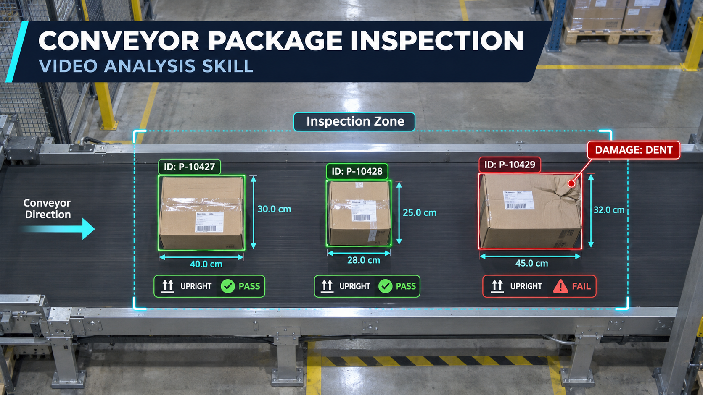

# Conveyor Package Inspection：运输带货物智能检测



   

一个用于分析用户上传的真实运输带视频的 Codex Skill。它按货物轨迹去重计数，并检查尺寸、面单是否朝上及可见破损，不是演示视频生成器。

## 功能特点

- 读取真实上传的视频，而不是合成检测动画。
- 为每件货物建立稳定 ID，并在穿过检测线时只计数一次。
- 输出尺寸或明确标注的尺寸估算。
- 判断面单位于上表面、侧面或无法确认。
- 识别压扁、凹陷、撕裂、穿孔、开缝、泄漏和严重变形等可见异常。
- 输出逐件检测表、异常时间点，并在工具支持时生成标注视频。

## 适用场景

- “分析这段运输带视频，一共有多少件货物？”
- “检测每个纸箱的尺寸、面单是否朝上以及是否破损。”
- “找出视频里的变形包裹并给出时间点。”
- “根据固定机位和标定板测量包裹尺寸。”

不用于从普通画面推算重量，也不应在没有标定条件时声称厘米级精确尺寸。

## 快速使用

将整个文件夹安装到 Codex Skills 目录，例如：

```text
~/.codex/skills/inspect-conveyor-packages/
```

上传视频后提出请求：

```text
使用 $inspect-conveyor-packages 分析我上传的运输带视频，逐件输出尺寸、面单是否朝上和破损情况。
```

若需要厘米尺寸，请同时提供固定机位、已知传送带宽度、标定板/标尺或深度数据。

## 工作流程

1. 检查视频质量、机位、运动方向和标定条件。
2. 选择固定检测区并建立货物轨迹。
3. 每条轨迹穿过检测线时计数一次。
4. 在最清晰的画面判断三个检测项目。
5. 输出结果表、异常证据和局限说明。
6. 工具允许时，另存标注视频，不覆盖原文件。

检测规则见 [`references/inspection-protocol.md`](references/inspection-protocol.md)，结果字段见 [`references/result-schema.md`](references/result-schema.md)。

## 能力边界

- 普通视频可以进行追踪、计数、面单朝向判断和明显外观破损筛查。
- 精确长宽高需要相机标定和几何/深度信息；没有标定时只提供估算。
- 重量不能从外观可靠得出，需要电子秤或可信的外部记录。
- 隐藏破损、内部物品损坏和非常细小的缺陷无法仅凭普通监控画面确认。

## 隐私、费用与资源

- Skill 本身不调用付费 API，也不包含模型权重。
- 分析工具及模型取决于运行环境；使用任何付费或云端服务前应先征得用户同意。
- 工厂视频可能包含人员、运单和商业信息，应优先本地处理并避免不必要上传。
- 长视频逐帧检测可能占用较多 CPU、内存和磁盘；默认先做轻量质量检查，再决定是否全量处理。

## 目录结构

```text
inspect-conveyor-packages/
├── SKILL.md
├── README.md
├── LICENSE
├── .gitignore
├── agents/
│   └── openai.yaml
├── assets/
│   └── cover.png
└── references/
    ├── inspection-protocol.md
    └── result-schema.md
```

## 致谢与许可

Skill 指导、结果协议和封面为本项目原创，采用 [MIT License](LICENSE)。实际运行时使用的视频解码器、视觉模型或第三方服务分别受其自身条款约束。

